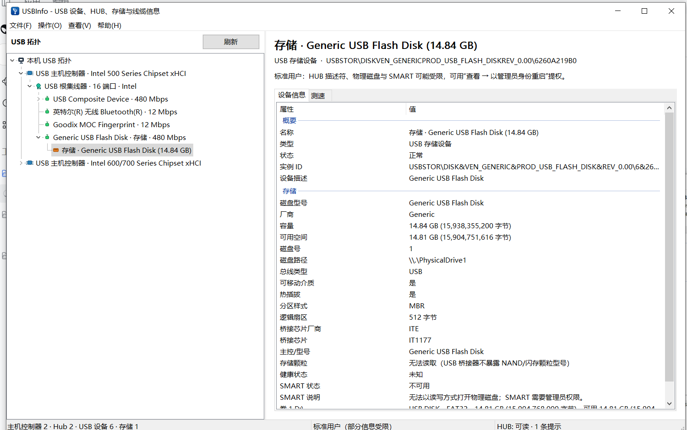
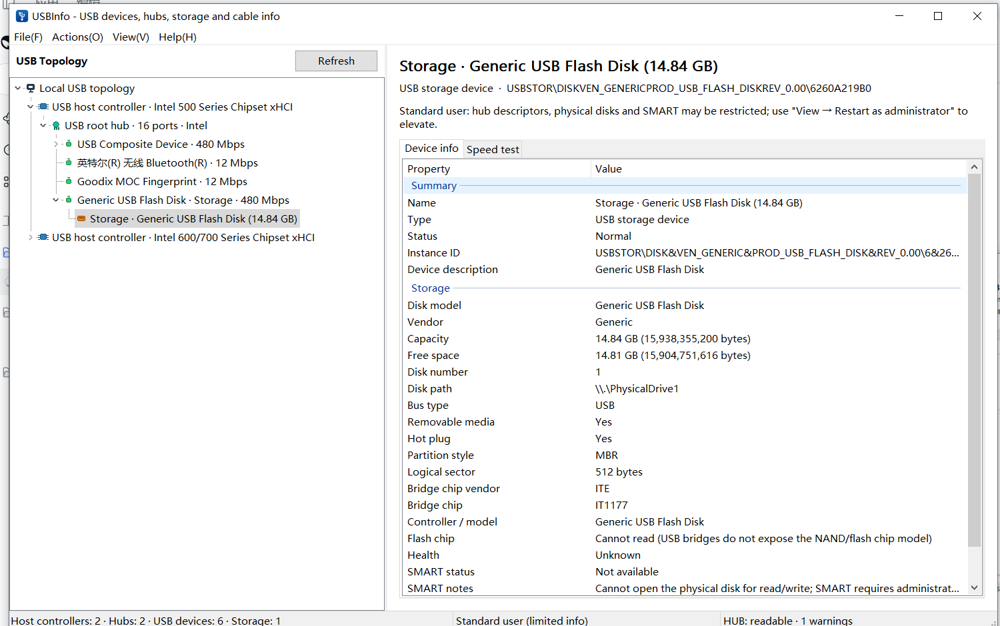

# USBInfo

Windows USB topology, hub, storage, SMART and throughput viewer built with **C++20 / WTL 10 / Win32**.

> 中文：Windows 下的 USB 拓扑、HUB、存储、SMART 与读写测速查看器。

[](https://github.com/anpho/USBinfo/actions/workflows/pr-build.yml)

USBInfo walks the PnP/USB tree, reads standard USB descriptors and hub port capabilities, correlates USB storage with volumes and bridges, and provides a file-based read/write benchmark with a live throughput chart.



## Features

- **USB cascade tree**: host controllers → root hubs → external hubs → devices → interfaces, with a compact title and full details in the right pane.
- **Hub and device information**: VID/PID, USB version, class/subclass/protocol, configuration/interface/endpoint descriptors, BOS capabilities, link speed, driver service/INF/version, PnP location.
- **USB storage**: capacity, free space, volumes, partition style, bus type, bridge/controller chip, SMART attachment; no fabricated NAND or cable data.
- **SMART / health**: ATA, SATA bridge, and NVMe paths when the device and driver expose them; the tab is hidden when no health data is available.
- **Benchmark**: sequential read/write and 4K random read/write (plus 4K sequential and 1 MiB random), with MB/s, IOPS, latency and a Task Manager-style throughput curve.
- **Report export**: full text report; every detail value and row can be copied from the context menu; driver rows can locate the driver file or INF directory.
- **Privacy-friendly**: no telemetry, no network access, no raw-disk writes.

## Languages

The UI ships with 8 languages:

| Language | Code |
|---|---|
| 简体中文 | zh-CN |
| English | en-US |
| Français | fr-FR |
| Deutsch | de-DE |
| Español | es-ES |
| 日本語 | ja-JP |
| 한국어 | ko-KR |
| Русский | ru-RU |

The language is selected automatically from the Windows display language. It can be changed at any time via **View → Language**, including **Automatic (System)**. Switching is immediate and does not rescan devices.



Translation resources live in `src/LanguageCore.inc`, `src/LanguageUi.inc`, and `src/LanguageData.inc`. New UI strings use `Tr(L"中文")` and a corresponding row in one of those tables.

## Requirements

- Windows 10/11 x64
- Visual Studio 2022/2026 with the Desktop development with C++ workload and ATL
- Windows 10 SDK
- WTL 10 is vendored in `third_party/wtl`

## Build

Open `USBInfo.sln` in Visual Studio and build `Release | x64`, or use MSBuild:

```bat
msbuild USBInfo.sln /m /p:Configuration=Release /p:Platform=x64
```

Output:

```text
bin\Release\USBInfo.exe
```

The Release build uses the static CRT (`/MT`) and does not require the VC++ redistributable.

Project files target `v145` for Visual Studio 2026. For Visual Studio 2022, use `/p:PlatformToolset=v143` or change the toolset in the project.

## Usage

```text
USBInfo.exe                  Launch the GUI
USBInfo.exe --report <path>  Write a full text report and exit
```

Run as administrator to unlock physical-disk IOCTLs, SMART and some hub descriptors. Standard-user mode still shows the USB topology, PnP properties, volumes and capacities.

Benchmarks write only a temporary file on the selected volume, never directly to the raw disk. The temporary file is deleted automatically.

## CI and versioning

`.github/workflows/pr-build.yml` builds a Release x64 package for every pull request. The version format is:

```text
yyyy.MM.dd.buildnumber
```

`buildnumber` is the monotonically increasing GitHub Actions run number. The workflow calls `tools/set-version.ps1` to update `src/Version.h`, detects the available toolset (`v145` on VS 2026 runners, `v143` on VS 2022 runners), builds with `vswhere`/MSBuild, and uploads `USBInfo-<version>-x64.zip` as an artifact.

## Project layout

```text
src/
  main.cpp                 WinMain and --report mode
  MainFrame.*              main window, menus, async scan, export
  TreePane.*               USB cascade tree
  DetailPane.*             detail tabs, SMART, context menus
  BenchmarkPane.*          benchmark UI and results
  ThroughputChart.*        live throughput chart
  UsbEnumerator.*          SetupAPI/CM and hub IOCTL enumeration
  StorageEnumerator.*      disk/volume/bridge/SMART correlation
  Smart.*                  ATA/SCSI/NVMe SMART readers
  Benchmark.*              file-based benchmark engine
  Model.*                  data model, detail rows, report
  DeviceProps.*            PnP/registry/device property helpers
  ChipDb.*                 VID/PID chip inference
  Language.*               language selection and translation lookup
  Language*.inc            8-language resource tables
  Util.*                   formatting helpers
  Version.h                generated version macros
tools/set-version.ps1      CI version writer
.github/workflows/         PR build workflow
third_party/wtl/           WTL 10 (MS-PL)
docs/                      screenshots
```

## Limitations

- Standard Windows USB APIs do not expose cable E-Marker, CC wiring, or cable impedance.
- NAND/flash chip models behind a USB bridge are generally unavailable.
- Chip models are inferred from VID/PID and marked as inferred.
- SMART depends on the bridge/driver passing ATA or NVMe commands through.
- Benchmark results depend on the bridge cache, SLC cache, file system and device temperature.
- USB4/Thunderbolt topology is shown only to the extent Windows exposes it.

## License

Application code may be used for learning and internal tools. WTL is used under the MS-PL license; see `third_party/wtl/MS-PL.txt`.

Project: <https://github.com/anpho/USBinfo>
